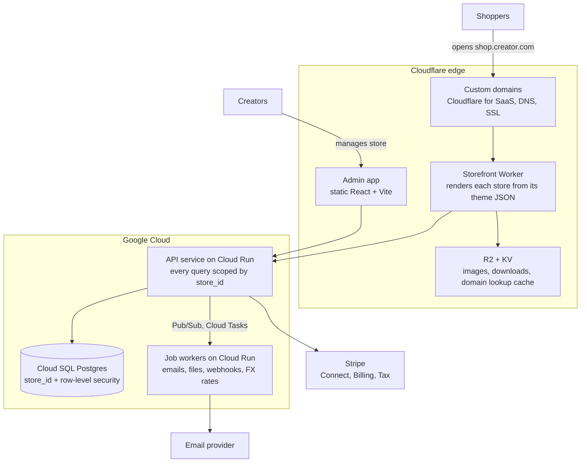

# Singularity — Plan

Snapshot of the plan as of Oct 11, 2026.

## Summary and decisions

A multi-merchant commerce platform where creators each run their own store and sell worldwide in their buyers' language and currency. Built solo and full-time, with no fixed deadline, on Cloudflare plus Google Cloud.

| Topic | Decision | Status |
| --- | --- | --- |
| Product type | Multi-merchant platform: each merchant gets a separate store | Decided |
| Niche | Creators selling digital products and merch; angle: sell worldwide in fans' language and currency | Decided |
| Team | Solo, full-time, professional developer | Decided |
| Timeline | No fixed deadline; aim for a 10-creator pilot | Proposed |
| Market | Global: multi-language and multi-currency storefronts at launch | Decided |
| Infrastructure | Cloudflare at the edge, Google Cloud for the API and database | Decided |
| Tech stack | React Router (Vite) storefront on Workers, React + Vite admin, Node.js + Fastify API | Decided |
| Payments | Platform payments (Stripe Connect) by default, plus bring-your-own gateways later | Decided |
| Pricing | Free: 5% fee · Pro: $29/mo + 1% · Business: $79/mo + 0% (Stripe fees extra) | Decided |
| Company | Register in Thailand first; overseas creators' fees billed on their monthly invoice (confirm with an accountant) | Decided |
| Tax | Creators are the sellers, with Stripe Tax at checkout (confirm with an accountant) | Decided |
| Storefront | Themes stored as section/block JSON; form editor first, visual editor later | Proposed |
| Name | Singularity · domain chosen later (candidate: singularity-shopping.store) | Proposed |

## Niche

Creators selling digital products and merch: digital goods need no shipping or inventory and sell across borders.

| Vertical | MVP build effort | Fit with global launch | Main risk |
| --- | --- | --- | --- |
| Creators & digital (chosen) | Low: instant delivery, simple catalog | High | Crowded; needs a clear differentiator |
| Restaurants & F&B | High: menus, modifiers, delivery zones | Low: local by nature | Needs partners in every city |
| B2B wholesale | High: price tiers, quotes, invoices | Medium | Long sales cycles |

Differentiator: sell to fans worldwide in their language and currency. Creator interviews were skipped, so validate this with the first pilot creators.

## MVP scope

| Area | In the MVP | Later |
| --- | --- | --- |
| Merchant onboarding | Sign up, create a store, free subdomain, connect payouts | Team roles beyond owner and staff |
| Products | Digital downloads, physical merch with variants, collections | Memberships, courses, license keys, bundles |
| Storefront | 2–3 themes, section editor with live preview, custom domain | Drag-and-drop editor, theme marketplace |
| Checkout | Cart, guest checkout, discount codes, local currency | Upsells, abandoned-cart emails |
| Payments | Stripe Connect | Bring-your-own gateways (e.g. PayPal) |
| Fulfilment | Expiring download links, order emails, manual shipping status | Shipping labels, print-on-demand |
| Orders & customers | Order list, refunds, customer list, CSV export | Segments, email marketing |
| Global | Multi-language storefronts, multi-currency prices, tax calculation | Per-country rules, local payment methods |
| Platform billing | Subscription plans plus transaction fee | Usage add-ons, annual plans |
| Platform admin | Merchant list, plans, support impersonation, audit log | Fraud scoring |
| Developer access | Public Storefront API (used by your own storefront) | App platform, third-party webhooks, SDKs |

## Tech stack

TypeScript end-to-end: it runs natively on both Cloudflare Workers and Cloud Run, so every part shares one language and one set of types.

- **Repo:** monorepo with pnpm workspaces + Turborepo.
- **Storefront:** React Router framework mode (built on Vite), server-rendered on Workers so product pages are indexable.
- **Admin:** React + Vite single-page app, served as static files from Cloudflare.
- **API:** Node.js with Fastify, in a container on Cloud Run.
- **Database:** Postgres on Cloud SQL, Drizzle ORM.
- **Jobs:** Pub/Sub and Cloud Tasks feeding a separate worker service.
- **Search:** Postgres full-text search to start.

Why Cloud Run and not Kubernetes: almost no operations work, scales to zero, cheap at low traffic, and the same container moves to Kubernetes later if needed. An optional Kubernetes learning track is in TASKS.md.

## System architecture

Cloudflare serves every storefront and handles creators' domains. Google Cloud runs the API and keeps all stores' data in one Postgres database.



- **Multi-tenancy:** one shared database; every row carries `store_id`, enforced by row-level security.
- **Custom domains:** Cloudflare for SaaS includes 100 custom hostnames on the free plan, then $0.10 each.
- **Files:** product images public on R2; paid downloads only through expiring signed links.
- **Environments:** local Docker for development; staging and production on Google Cloud.
- **Domain:** a setting (`PLATFORM_DOMAIN`), `localhost` in development; needed from task 1.16.

## Core data model

Every table except Plan carries `store_id`. Money is always an integer in the currency's smallest unit plus a currency code.

| Entity | Belongs to | Key fields |
| --- | --- | --- |
| Store | Platform | name, handle, default locale, default currency, plan, status |
| Domain | Store | hostname, verification status, SSL status, primary flag |
| StaffMember | Store | user, role (owner, admin, staff) |
| Product | Store | type (digital or physical), status, handle |
| Variant | Product | SKU, option values, base price |
| Price | Variant | currency, amount (optional fixed price per currency) |
| DigitalAsset | Variant | R2 object key, file size, download limit |
| Collection | Store | handle, rules or manual list |
| Customer | Store | email, locale, country |
| Cart | Store | lines, currency, totals |
| Order | Store | number, customer, currency, subtotal, tax, total, status |
| OrderLine | Order | variant, quantity, unit price (copied at time of sale) |
| Payment | Order | provider, provider reference, amount, status |
| Refund | Payment | amount, reason, status |
| DownloadGrant | OrderLine | token, expiry, download count |
| ThemeTemplate | Store | template name, draft JSON, published JSON, version |
| Translation | Store | entity, field, locale, value |
| Subscription | Store | plan, Stripe subscription ID, status |
| Plan | Platform | name, monthly price, transaction fee rate |
| AuditEvent | Store | actor, action, target, time |

## Storefront and theming

Each page is JSON: an ordered list of sections with settings. The form editor (MVP) and the drag-and-drop editor (later) both edit the same JSON.

```json
{
  "template": "home",
  "sections": {
    "hero-1": {
      "type": "hero",
      "settings": {
        "heading": { "en": "New drop is live", "ja": "新作公開中" },
        "image": "asset:img_123"
      }
    },
    "grid-1": {
      "type": "product-grid",
      "settings": { "collection": "featured", "columns": 3 }
    }
  },
  "order": ["hero-1", "grid-1"]
}
```

- Sections are React components, each with a settings schema that generates its editor form.
- Merchants edit a draft; publishing copies it to published and clears the edge cache.
- Text settings hold one value per locale, falling back to the store's default.

## Payments and revenue

- Shoppers pay through Stripe-hosted fields; the charge lands in the creator's connected account.
- Per Stripe, a Thai platform can't take an application fee from merchants outside Thailand, so overseas creators' fees go on their monthly invoice.
- Bring-your-own gateways sit behind one `PaymentProvider` interface; their fees are invoiced monthly.

Competitor pricing, checked October 2026 (payment processing fees extra):

| Platform | Monthly fee | Platform fee per sale |
| --- | --- | --- |
| Gumroad | $0 | 10% + 50¢ on direct sales |
| Payhip | $0 / $29 / $99 | 5% / 2% / 0% |
| Stan Store | $29 / $99 | 0% |
| Shopify Basic | $39 billed monthly | 2%, only with third-party payment providers |
| Singularity (planned) | $0 / $29 / $79 | 5% / 1% / 0% |

Tax: creators are the sellers, with Stripe Tax at checkout. This is not legal or tax advice; confirm with an accountant.

## Going global

| Area | MVP approach |
| --- | --- |
| Languages | Creators choose languages; text stored per locale with fallback |
| URLs and SEO | Locale in the path (`/ja/products/...`) plus `hreflang` tags |
| Currencies | Base price converted with daily FX rates; optional fixed prices per currency |
| Tax | Calculated at checkout by Stripe Tax |
| Privacy | Consent banner, data export and deletion (GDPR, PDPA) |
| Card security | Stripe-hosted payment fields only |
| Admin UI | English first, strings in translation files |

## Roadmap

Rough estimates for one full-time developer. Phase 0 (interviews) is skipped by choice; recruit pilot creators during Phase 2.

1. **Phase 1 · Foundation (~4–6 weeks):** monorepo, auth, multi-tenant Postgres, store creation, subdomains, CI, deploys. Gate: a new store goes live on its own subdomain.
2. **Phase 2 · Sell (~6–8 weeks):** products, themes, editor, cart, checkout, Stripe Connect, orders, downloads, emails. Gate: first real sale.
3. **Phase 3 · Go global (~4–6 weeks):** languages, currencies, tax, custom domains, plans and fees. Gate: sales in 2+ currencies and a first paid plan.
4. **Phase 4 · Pilot to launch (~4 weeks):** onboarding, analytics, security, monitoring, backups, PayPal, legal pages. Gate: 10 paying merchants.
5. **Phase 5 · Grow (ongoing):** drag-and-drop editor, memberships, app platform, headless SDK.

## Top risks

| Risk | Mitigation |
| --- | --- |
| No one switches | Recruit pilot creators during Phase 2; treat the pilot as the real test |
| Data leaks between stores | Row-level security, tests that query as the wrong store, review every data change |
| Payment country limits | Thailand first; invoice overseas fees; consider a US or UK entity later |
| Tax liability | Creators are sellers; Stripe Tax; professional advice |
| Fraud and chargebacks | Stripe Radar, download limits, payout holds for new stores |
| Scope creep | Stick to the MVP table |
| Solo bus factor | Infrastructure as code, runbooks, managed services |
| Cloud costs | Develop locally; budget alerts from day one |

## Open items

- Check company country and tax setup with an accountant before Phase 2.
- Choose and buy the domain before task 1.16.

## Sources

- [Stripe: Thailand support for marketplaces](https://support.stripe.com/questions/stripe-thailand-support-for-marketplaces)
- [Stripe: businesses Connect can't support in Thailand](https://support.stripe.com/questions/are-there-any-businesses-that-stripe-cant-support-on-connect-in-thailand)
- [Cloudflare for SaaS plans](https://developers.cloudflare.com/cloudflare-for-platforms/cloudflare-for-saas/plans/)
- [Cloudflare Workers pricing](https://developers.cloudflare.com/workers/platform/pricing/)
- [Google Cloud free program](https://cloud.google.com/free)
- [Gumroad pricing](https://gumroad.com/pricing) · [Payhip pricing](https://payhip.com/pricing) · [Shopify pricing](https://www.shopify.com/pricing) · [Stan Store pricing review](https://latuos.com/stan-store-pricing/)
